# Габриелян Григорий ЛА-4 Лабораторная №4

# Задание 1

## Задача 3

### Текст задачи

Даны упорядоченные списки L1 и L2. Вставить элементы списка L2 в список L1, не нарушая его упорядоченности.

Использовать `List`.

### Алгоритм решения

1. Ввести размеры двух списков от 0 до 10000 и целочисленные элементы. Списки упорядочены по неубыванию. При вводе очередного элемента проверить, что он не меньше предыдущего.
2. Запомнить индекс последнего исходного элемента L1. Добавить элементы L2 в конец L1 методом `AddRange`, чтобы в первом списке появилось место для объединённого результата.
3. Установить три индекса: последние исходные элементы L1 и L2 и последняя позиция результата в расширенном L1.
4. Сравнивать текущие элементы исходных списков. Больший записывать в конец свободной части результата, уменьшая соответствующие индексы.
5. Продолжать, пока не закончатся элементы L2. Оставшиеся элементы L1 уже находятся на своих местах. Повторения сохраняются.

Слияние выполняется за O(n + m), где n и m — размеры списков. Многократных вставок в середину `List` и повторных сдвигов всего списка нет.

### Тестирование

L1 = [-3, 1, 1, 8], L2 = [-5, 1, 2, 10]. Получен L1 = [-5, -3, 1, 1, 1, 2, 8, 10]. Проверены отрицательные числа, повторения и добавление с обеих сторон.

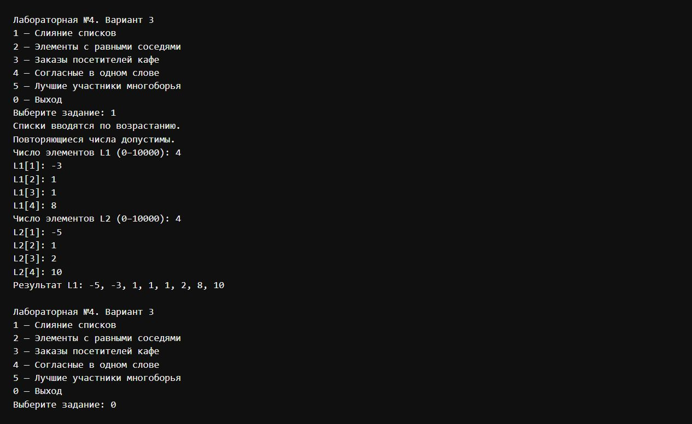

Текст вместо размера, отрицательный размер и нарушение порядка элементов отклоняются. При пустом L2 первый список сохраняется.

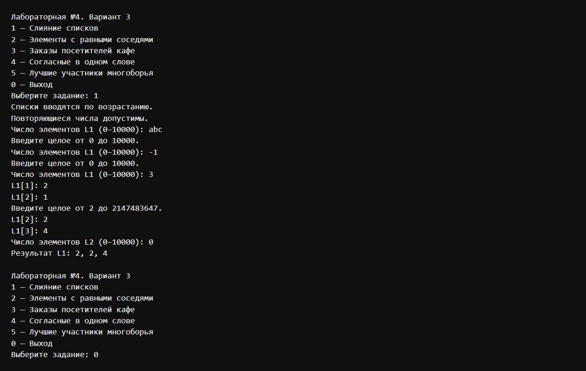

# Задание 2

## Задача 3

### Текст задачи

Подсчитать количество элементов списка L, у которых равные «соседи».

Использовать `LinkedList`.

### Алгоритм решения

1. Ввести размер и элементы списка, затем создать `LinkedList<int>`.
2. Начать обход со второго узла и продолжать, пока у текущего узла существует следующий.
3. Сравнить значения предыдущего и следующего узлов. Если они равны, увеличить счётчик.
4. Перейти к следующему узлу и вывести итоговый счётчик после завершения обхода.

Первый и последний узлы не учитываются: у каждого из них только один сосед. Замыкание списка в кольцо в этом варианте задания не указано. Для списка длиной меньше трёх результат равен нулю. Сложность обхода — O(n).

### Тестирование

Для L = [1, 2, 1, 2, 1] равные соседи есть у второго, третьего и четвёртого элементов. Ответ: 3.

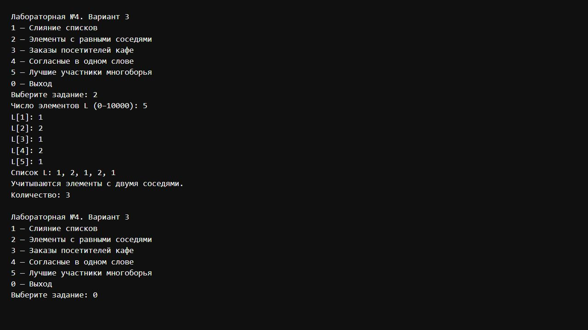

Для пустого списка ответ равен 0, обращения к отсутствующим узлам не выполняются.

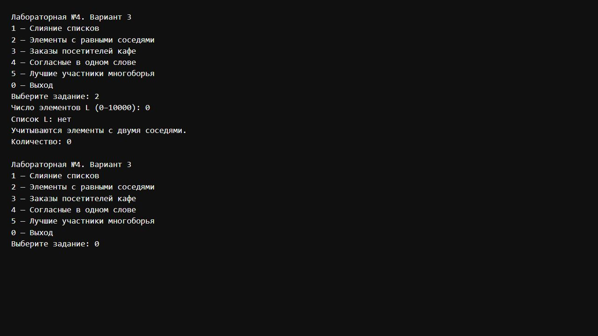

# Задание 3

## Задача 3

### Текст задачи

Задан некоторый набор блюд в кафе. Определить для каждого из блюд, какие из них заказывали все посетители, какие — некоторые из посетителей, и какие не заказывал никто.

Использовать `HashSet`.

### Алгоритм решения

1. Ввести набор уникальных непустых названий блюд и положительное количество посетителей.
2. Создать `orderedByAll` как копию меню, а `orderedByAnyone` — как пустое множество.
3. Для каждого посетителя ввести множество `orders`. Разрешить пустой заказ; проверить наличие блюд в меню и отсутствие повторов в заказе.
4. Выполнить `orderedByAll.IntersectWith(orders)`: пересечение оставляет только блюда, которые есть и в накопленном множестве, и в заказе текущего посетителя. После всех посетителей в нём останутся блюда, заказанные каждым.
5. Выполнить `orderedByAnyone.UnionWith(orders)`: объединение добавляет блюда текущего посетителя. После всех посетителей множество содержит блюда, заказанные хотя бы одним человеком.
6. Создать копию меню и применить `orderedByNobody.ExceptWith(orderedByAnyone)`. Получим блюда, которые никто не заказывал.
7. Применить `orderedByAnyone.ExceptWith(orderedByAll)`. В `orderedByAnyone` останутся блюда, заказанные некоторыми, но не всеми.

Например, если меню — `{суп, салат, чай, кофе}`, первый посетитель заказал `{суп, салат, чай}`, а второй — `{суп, чай}`, то:

- пересечение заказов равно `{суп, чай}` — заказывали все;
- объединение заказов равно `{суп, салат, чай}` — заказывал хотя бы один;
- разность объединения и пересечения равна `{салат}` — заказывали некоторые, но не все;
- разность меню и объединения равна `{кофе}` — не заказывал никто.

`ExceptWith` изменяет множество, у которого вызывается метод. Сначала создаём копию меню для группы «никто», затем удаляем из `orderedByAnyone` блюда, заказанные всеми. Группы результата не пересекаются; «некоторые» здесь означает «хотя бы один, но не все».

### Тестирование

Меню: суп, салат, чай, кофе. Первый посетитель заказал суп, салат и чай; второй — суп и чай. Все заказывали суп и чай, некоторые — салат, никто — кофе.

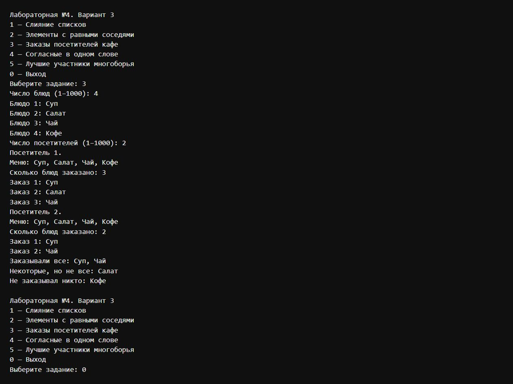

Пустое название и блюдо вне меню отклоняются. Если второй посетитель ничего не заказал, общих для всех блюд нет.

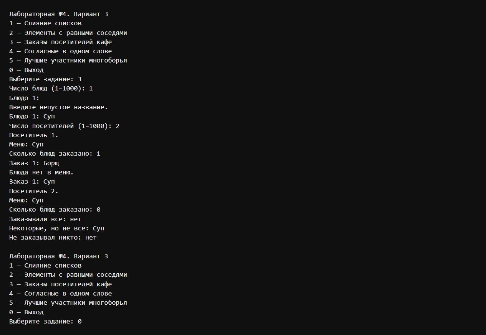

# Задание 4

## Задача 3

### Текст задачи

Файл содержит текст на русском языке. Напечатать в алфавитном порядке все согласные буквы, которые входят ровно в одно слово.

Использовать `HashSet`.

### Алгоритм решения

1. Ввести число строк текста и сами строки с клавиатуры. Отдельным методом `FillTextFile` записать их в `data/russian-text.txt`.
2. Прочитать файл и выделить слова регулярным выражением `[а-яё]+`. Знаки препинания, цифры и пробелы разделяют слова. Буквы привести к нижнему регистру.
3. Создать множества `seen` — согласные, встретившиеся хотя бы в одном слове, `repeated` — согласные из нескольких слов, `wordLetters` — буквы текущего слова.
4. Перебирать буквы каждого слова. Если символ — согласная, добавить его в `wordLetters`. Метод `Add` возвращает `true`, только если эта буква ещё не встречалась в текущем слове. Если буква уже есть в `seen`, добавить её в `repeated`; иначе добавить в `seen`.
5. Удалить из `seen` все элементы `repeated`.
6. Перебрать строку согласных `бвгджзйклмнпрстфхцчшщ` в алфавитном порядке и вывести буквы, оставшиеся в `seen`.

Повторение буквы внутри одного слова не исключает её из ответа. Два одинаковых слова в разных позициях текста считаются двумя словами.

### Тестирование

Для текста «Мама мыла раму. Кот спит!» получен результат: к, л, п, р, с. Буква м встречается в нескольких словах, т — в двух словах; они исключены.

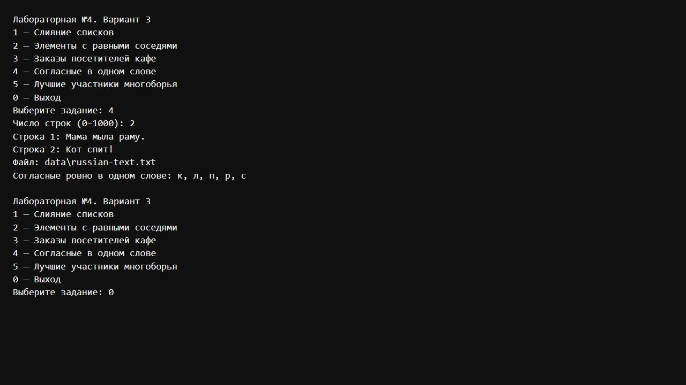

Для текста «кот кот» подходящих согласных нет: каждая встречается в двух словах.

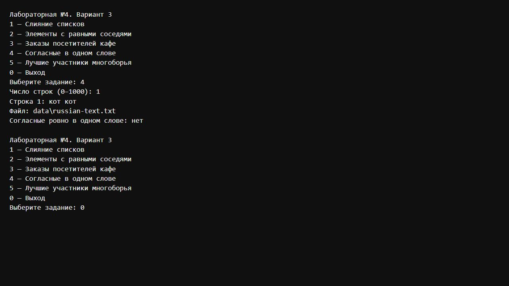

# Задание 5

## Задача 3

### Текст задачи

На вход программы подаются сведения о результатах соревнований по школьному многоборью. Многоборье состоит из соревнований по четырём видам спорта, участие в каждом из которых оценивается баллами от 0 до 10 (0 баллов получает ученик, не принимавший участия в соревнованиях по данному виду спорта). Победители определяются по наибольшей сумме набранных баллов. Известно, что общее количество участников соревнований не превосходит 100.

В первой строке вводится количество учеников, принимавших участие в соревнованиях, N. Далее следуют N строк, имеющих следующий формат:

```text
<Фамилия><Имя><Баллы>
```

Здесь `<Фамилия>` — строка, состоящая не более чем из 20 символов; `<Имя>` — строка, состоящая не более чем из 15 символов; `<Баллы>` — строка, содержащая четыре целых числа, разделённых пробелом, соответствующих баллам, полученным на соревнованиях по каждому из четырёх видов спорта. При этом `<Фамилия>` и `<Имя>`, `<Имя>` и `<Баллы>` разделены одним пробелом.

Примеры входных строк:

```text
Иванова Мария 5 8 6 3
Петров Сергей 9 9 5 7
```

Напишите программу, которая будет выводить на экран фамилии и имена трёх лучших участников многоборья. Если среди остальных участников есть ученики, набравшие то же количество баллов, что и один из трёх лучших, то их фамилии и имена также следует вывести. При этом имена и фамилии можно выводить в произвольном порядке.

Исходные данные хранятся в текстовом файле; заполнение исходного файла необходимо организовать отдельным методом. Использовать `Dictionary` или `SortedList`. Решение должно быть оптимальным.

### Алгоритм решения

1. Методом `FillResultsFile` ввести N от 1 до 100 и N записей. Проверить длины фамилии и имени, наличие в них только букв, формат строки и четыре целых балла от 0 до 10. Сохранить данные в `data/competition.txt`.
2. Открыть файл для последовательного чтения. Для каждого участника вычислить сумму четырёх баллов.
3. Добавить фамилию и имя в `Dictionary<int, List<string>>`, где ключ — сумма баллов, значение — список участников с этой суммой.
4. Перебрать возможные суммы от 40 до 0. Если для суммы есть группа, вывести её целиком и увеличить число выбранных участников на размер группы.
5. Остановиться после группы, с которой число выведенных участников достигло трёх. Если всего участников меньше трёх, вывести всех.

Выбираются три лучших участника с учётом равенства баллов, а не три различных значения суммы. Например, при результатах 40, 40, 40, 35 выводятся только первые три участника. При результатах 40, 39, 38, 38 выводятся все четверо.

Файл читается один раз. Каждый участник добавляется в словарь один раз; дополнительно проверяется не более 41 возможной суммы. Сложность — O(N + 41), то есть O(N); память — O(N + 41). Сортировки участников и вложенного сравнения всех пар нет.

### Тестирование

Суммы участников: 40, 39, 38, 38, 20. Выведены первые четыре участника: оба результата 38 включаются в ответ.

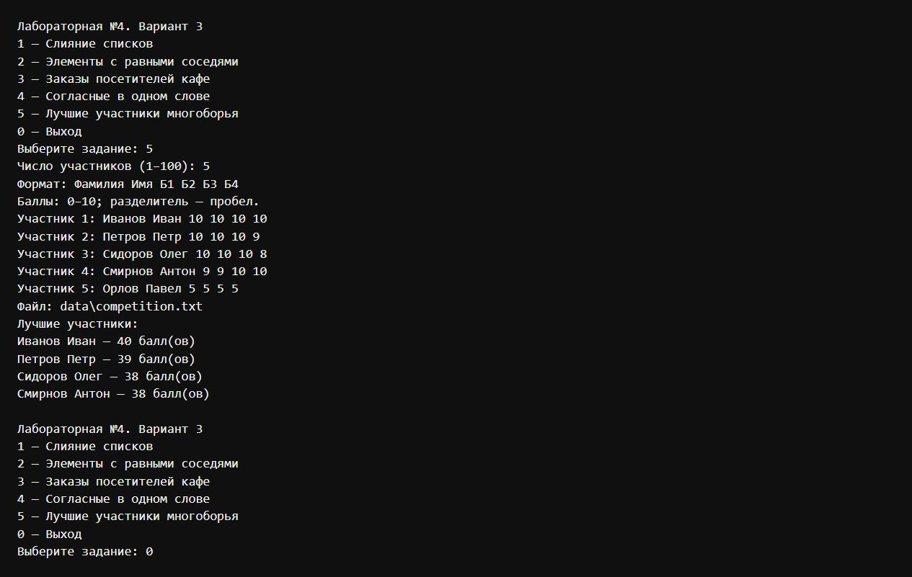

Суммы 40, 40, 40, 36. Выведены только три участника с суммой 40.

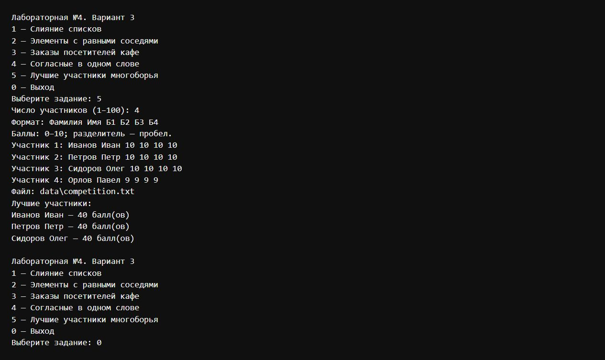

Балл 11 отклоняется. После исправления записи единственный участник с суммой 10 выводится в ответе.

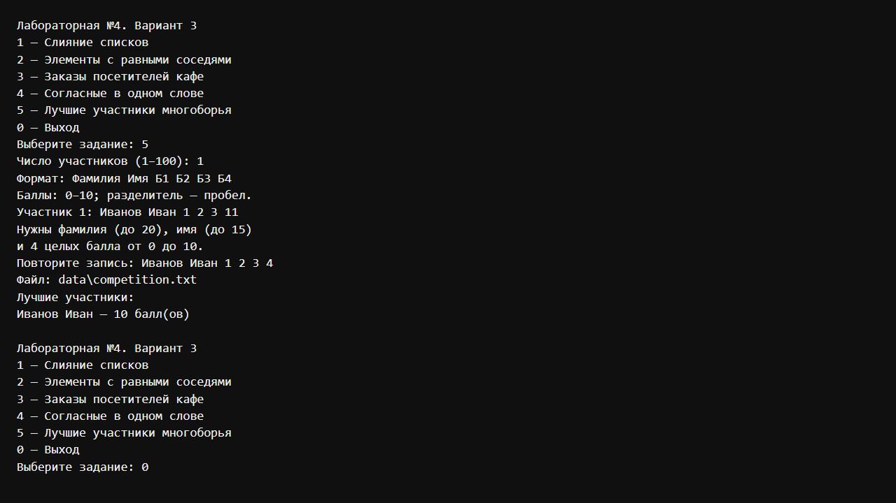

# Задание 6

## Задача 3

### Текст задачи

Реализовать класс `Point`. Поля: `double x`, `double y` — координаты точки. Метод: вычислить расстояние от одной точки до другой. Результат должен быть типа `double`.

В классе необходимо реализовать поля, свойства, конструкторы, перегрузку метода `ToString()` для вывода полей и заданный метод согласно варианту. Протестировать все методы, включая конструкторы. Вводимые пользователем данные проверять на корректность. Задания 6 и 7 решаются в одном проекте отдельно от заданий 1–5.

### Алгоритм решения

1. В отдельном файле `Point.cs` создать класс `Point` с закрытыми полями `_x`, `_y` и обычными свойствами `X`, `Y` с явно записанными `get` и `set`.
2. Реализовать конструктор без параметров — точка (0; 0), конструктор с двумя координатами и конструктор копирования. Разместить их перед свойствами.
3. В свойствах отклонять `NaN` и бесконечности. При вводе координат разрешить десятичную точку и запятую, некорректный ввод запрашивать повторно.
4. Методом `DistanceTo` вычислить расстояние √((x₁ − x₂)² + (y₁ − y₂)²). Для вычисления использовать `double.Hypot`, который позволяет избежать переполнения при возведении больших координат в квадрат.
5. Перегрузить `ToString()` для представления точки в формате `(x; y)`.
6. В классе `PointExamples` показать все конструкторы, изменить свойства копии, вывести исходную точку и вычислить расстояние до второй введённой точки.

### Тестирование

Проверены конструктор без параметров, создание P = (1; 2), копирование и изменение свойств копии до (10; 20). Исходная P сохраняется. Для Q = (4; 6) расстояние равно 5.

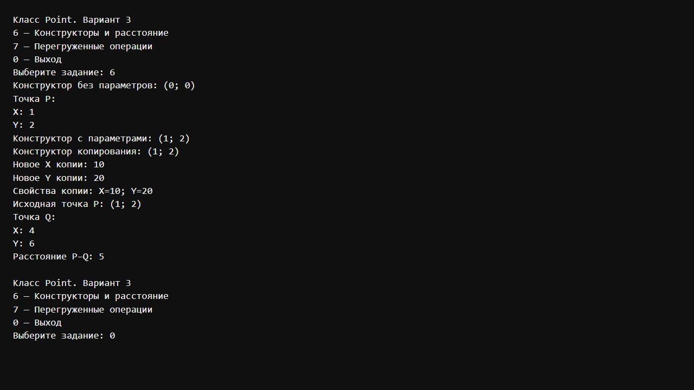

Текст, `NaN` и бесконечность отклоняются. Расстояние между двумя точками (0; 0) равно 0.

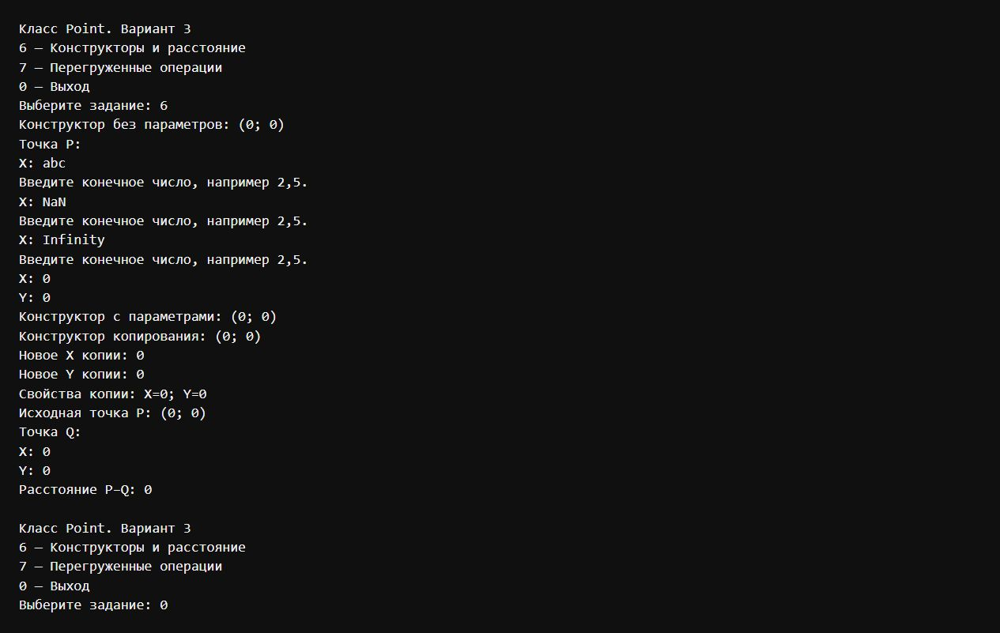

# Задание 7

## Задача 3

### Текст задачи

Добавить к классу `Point` перегруженные операции и протестировать все методы.

Унарные операции:

- `++` — увеличить координату x на 1;
- `--` — уменьшить координату x на 1.

Операции приведения типа:

- `int` (явная) — результатом является целая часть координаты x;
- `double` (неявная) — результатом является координата y.

Бинарные операции:

- `+ Point p` — вычисляется расстояние до точки p. Результатом должно быть вещественное число;
- `+ целое число` — лево- и правосторонние операции. Увеличивается координата x, результатом является объект типа `Point`.

### Алгоритм решения

1. В `Point` перегрузить `++` и `--`, возвращая новую точку с изменённым x и прежним y. Проверить префиксную и постфиксную формы.
2. Реализовать `explicit operator int` через приведение x к `int` в контексте `checked`. Дробная часть отбрасывается в направлении нуля. При выходе за диапазон `int` показать понятное сообщение.
3. Реализовать `implicit operator double`, возвращающий y.
4. Перегрузить бинарный `+` для двух точек через вызов `DistanceTo`.
5. Перегрузить `Point + int`, создавая новую точку с x, увеличенным на заданное число. Для `int + Point` вызвать уже реализованный оператор.
6. В `PointExamples` ввести две точки и целое число, вывести результаты каждой операции. Исходную точку сохранить для сравнения.

### Тестирование

Для P = (2,5; −3), Q = (5,5; 1) и сдвига 4 расстояние равно 5. Явное преобразование даёт 2, неявное — −3. Обе формы сложения с числом дают (6,5; −3). `++` и `--` изменяют только x; префиксная и постфиксная формы возвращают соответствующие значения.

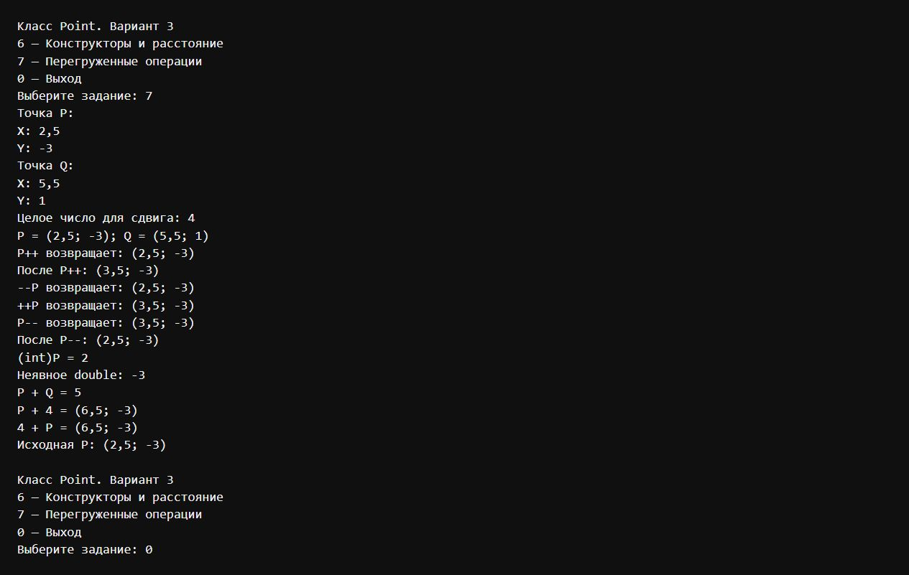

Для P = Q = (−2,5; 1,5) расстояние равно 0, преобразование к `int` даёт −2. Сдвиг на −3 в обоих порядках даёт (−5,5; 1,5).

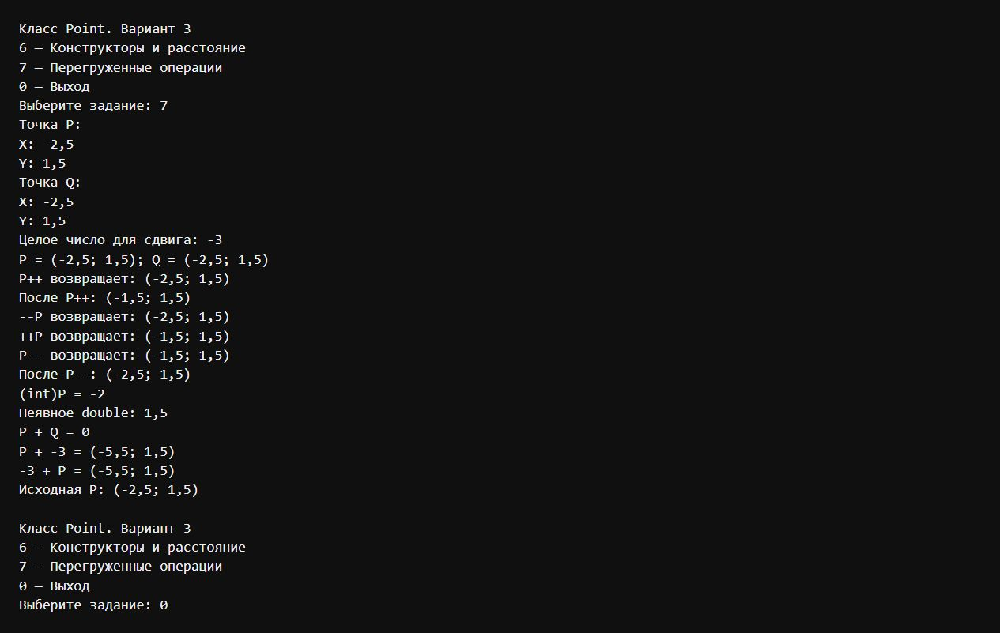

При x = 3000000000 преобразование к `int` сообщает о выходе за диапазон, выполнение остальных операций продолжается.

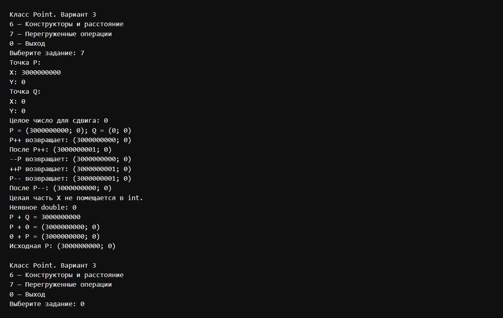
